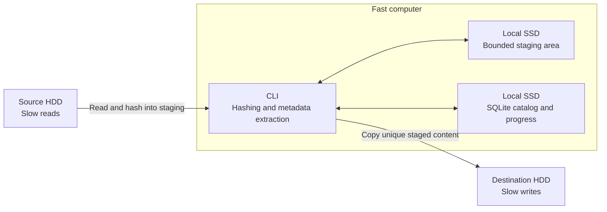
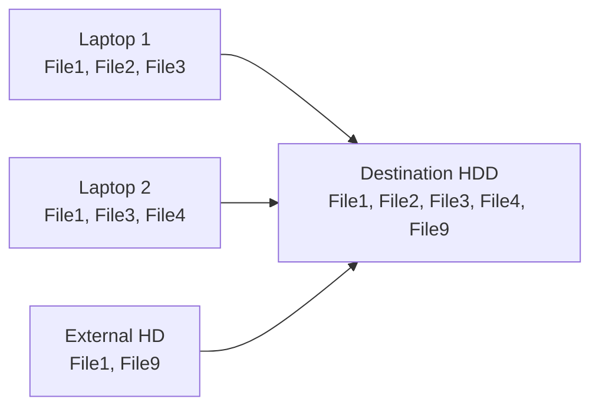
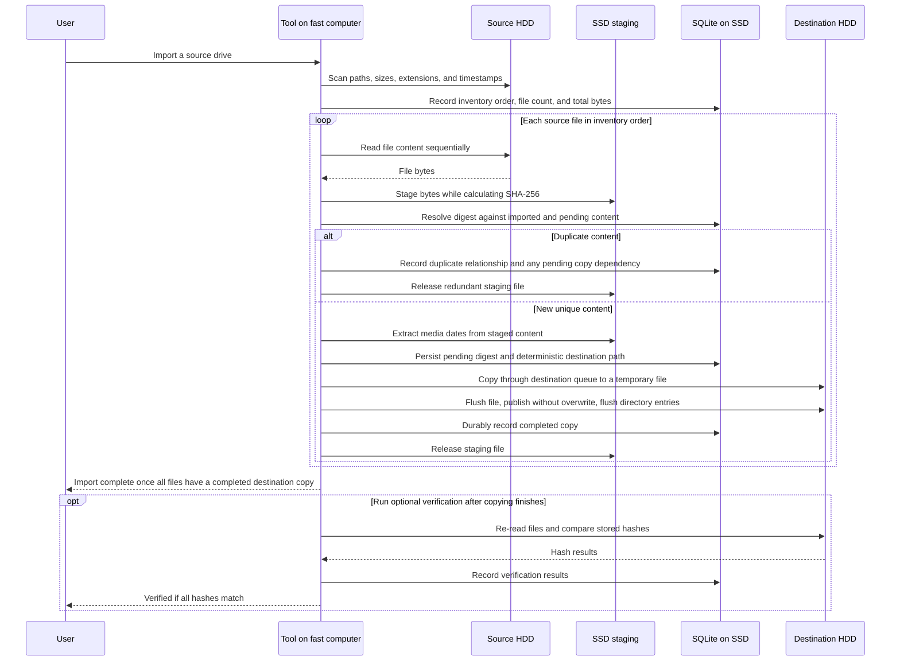

# unduplicator

A resumable, copy-only CLI that imports files from removable drives into one destination. It keeps one SHA-256-identified copy of each unique file and tracks progress in SQLite.

## Setup

The tool is designed for a fast computer with two attached slow HDDs:

- **Fast computer:** runs the CLI, hashing, and media metadata extraction.
- **Local SSD:** holds the SQLite catalog, resumable progress, and temporary staging files.
- **Source HDD:** contains the files to import.
- **Destination HDD:** receives the organized, unique files.

The performance goal is to minimize repeated source reads and HDD seeks while allowing the source and destination to work at the same time.

## Import flow

Matching SHA-256 content is stored once, across all imports.

## Import sequence

## Phases

1. **Inventory** — scan source paths, sizes, extensions, and original timestamps into SQLite without reading file content. Record the total file count and byte count for progress reporting. Keep files from the same directory together and retain traversal order as the processing queue. No separate size-grouping or planning pass is needed: every file will be hashed during processing.
2. **Process and import** — read each source file into SSD staging while calculating its full SHA-256 digest. Resolve duplicates against both completed imports and unique content already queued in this run. Extract media dates from staged unique files, determine their destination paths, and copy them from SSD to the destination HDD. Release staging files when they are no longer needed.
3. **Verify (optional)** — after copying finishes, re-read destination files, preferably in recorded write order, and compare their digests. Mark a run `verified` only if every required digest matches. Hashing during transfer does not replace this destination reread.

The sequence diagram shows the dependencies for each file. During phase 2, the source can stage the next file while the destination copies a previously staged file. SSD staging normally allows one full source read per file and one destination write per unique file. Duplicate detection still requires the full source digest; duplicate content is discarded from staging without being written to the destination.

## Progress

Show completed source files against the inventory total, such as `4 of 100000 done`, along with bytes read, destination copy progress, and an approximate time remaining. Count a source file as done only when its destination copy is durably complete; duplicates of pending content wait for that shared copy to complete.

Estimate time from observed byte throughput and remaining source reads and destination writes, accounting for overlap between the disks and extra reads in the oversized-file fallback. File counts alone give poor estimates when file sizes vary. The amount of unique content is initially unknown, so refine the estimate as processing discovers duplicates and show `Estimating…` until enough work has completed. Include the remaining destination queue after source reading finishes. Optional verification has its own progress and estimate.

## HDD scheduling and staging

- Use one active content reader per physical source HDD and one active writer per physical destination HDD. Overlap work across the two disks, with hashing and metadata work on the fast computer.
- Use large buffered transfers and bounded queues. Avoid interleaving several file streams on the same HDD or mixing destination verification with copying.
- Preserve directory locality when reading. Traversal order is a practical heuristic, not a guarantee of physical disk order.
- Give SSD staging a configurable space budget; it does not need to hold the entire import. Pause source reads when the budget is full and resume as completed files release space.
- For a file larger than the staging budget, fall back to hashing it on the source, then rereading it for copying only if it is unique. Extract any required metadata from the source in this fallback. This costs extra source I/O but keeps staging bounded.
- Keep destination naming and duplicate representative selection deterministic, independent of worker completion order.
- Index SQLite digest lookups and batch progress updates into short transactions. Track staged, pending, and completed content so interrupted work can resume. Use the finalization order below when committing completed copies, including batched commits.

## Copy finalization and crash recovery

1. Persist the pending digest, source reference, and intended destination path in SQLite before starting the destination copy.
2. Write to a temporary file on the destination filesystem. Flush the completed file to durable storage, then atomically publish it at the final path without replacing an existing file. Flush the affected directory entries, including newly created parent directories, before proceeding.
3. Durably commit the completed state in SQLite, then release the staging file. Duplicates linked to this content become complete only after this commit.

On restart, reconcile pending records with destination files and staging files. If the final destination file already exists, check its digest before adopting it as complete; this handles a crash after publication but before the SQLite commit. Validate recovered staging or temporary content before reuse, and retry incomplete copies from valid staging or the unchanged source. Never overwrite a conflicting final file. Failed copies and their dependent duplicates remain unfinished and must be reported; the run is complete only when every inventoried file has a completed destination copy.

## Source safety

The tool never modifies, moves, or deletes source files.

## Destination

- Media: `/Media/YYYY/YYYY-MM/YYYY-MM-DD/`
- Media with unknown dates: `/Media/Unknown/`
- Other files: `/Other/`
- Different content with the same destination name: add a deterministic SHA-256 suffix; never overwrite.

Date priority: image/video metadata, filename, original source filesystem timestamps, then `Unknown`. Staging timestamps do not replace source timestamps. Filesystem timestamps may not be capture dates.

## Supported media

- Images: `.jpg` `.jpeg` `.png` `.heic` `.heif` `.gif` `.bmp` `.tiff` `.tif` `.webp`
- Videos: `.mp4` `.mov` `.avi` `.mkv` `.wmv` `.m4v` `.3gp` `.flv`
- Everything else goes to `/Other/`.

## Operating assumptions

- Source contents, paths, and metadata remain unchanged throughout an import and any resumed work. The tool relies on this stability, including when oversized files are read twice; detecting external source changes is out of scope.
- The destination is changed only by this tool, and the same destination is used across imports and resumes. Completed catalog entries are trusted. Detecting external edits, deletions, or replacement drives is out of scope.
- The local SQLite catalog is retained. If it is lost, the import will be redone from the sources. Catalog backup and automatic reconstruction after catalog loss are out of scope.
