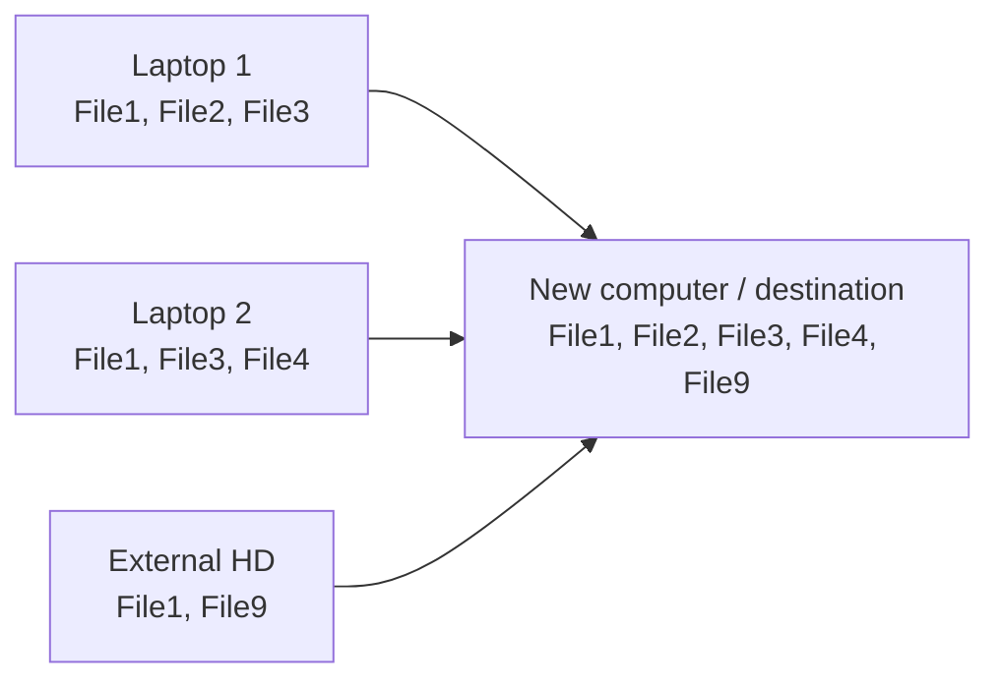
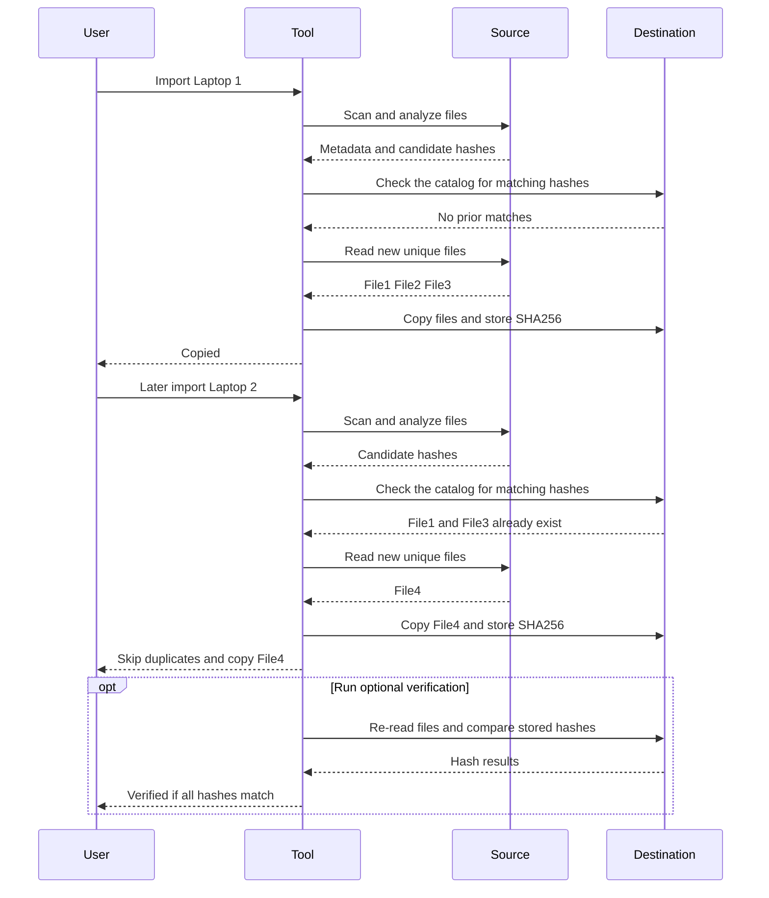

# unduplicator

A resumable, copy-only CLI that imports files from removable drives into one destination. It keeps one SHA-256-identified copy of each unique file and tracks progress in SQLite.

## Import flow

Matching SHA-256 content is stored once, across all imports.

## Import sequence

## Phases

1. **Scan** — record paths, sizes, extensions, and timestamps; do not read file content.
2. **Analyze** — extract dates and hash same-size duplicate candidates.
3. **Organize** — copy unique files and store their SHA-256 digests.
4. **Verify (optional)** — re-read destination files and compare digests. Mark a run `verified` only if every digest matches.

Keep source files unchanged during an import. The tool never moves or deletes them.

## Destination

- Media: `/Media/YYYY/YYYY-MM/YYYY-MM-DD/`
- Media with unknown dates: `/Media/Unknown/`
- Other files: `/Other/`
- Different content with the same destination name: add a deterministic SHA-256 suffix; never overwrite.

Date priority: image/video metadata, filename, filesystem timestamps, then `Unknown`. Filesystem timestamps may not be capture dates.

## Supported media

- Images: `.jpg` `.jpeg` `.png` `.heic` `.heif` `.gif` `.bmp` `.tiff` `.tif` `.webp`
- Videos: `.mp4` `.mov` `.avi` `.mkv` `.wmv` `.m4v` `.3gp` `.flv`
- Everything else goes to `/Other/`.
