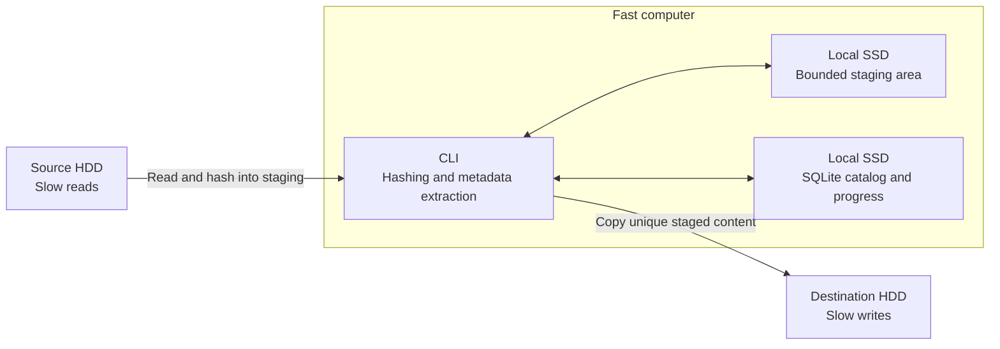
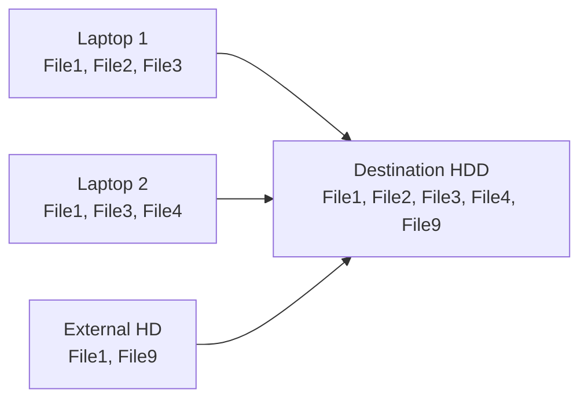
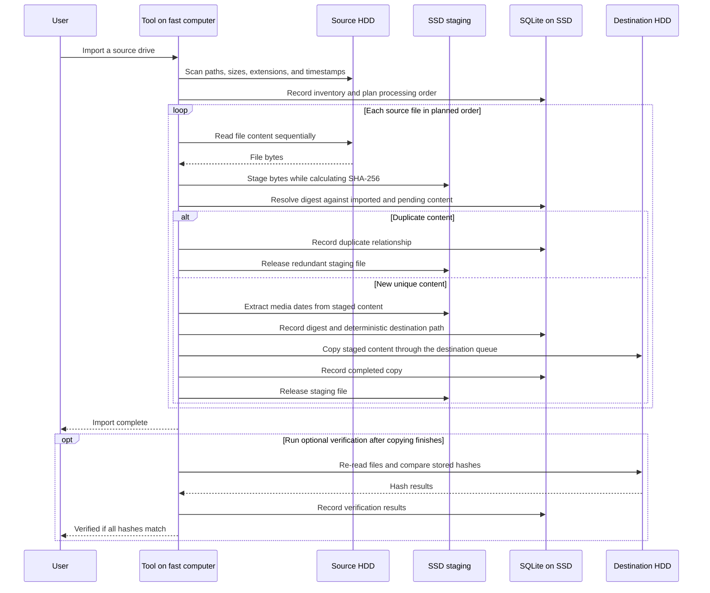

# unduplicator

A resumable, copy-only CLI that imports files from removable drives into one destination. It keeps one SHA-256-identified copy of each unique file and tracks progress in SQLite.

## Setup

The tool is designed for a fast computer with two attached slow HDDs:

- **Fast computer:** runs the CLI, hashing, and media metadata extraction.
- **Local SSD:** holds the SQLite catalog, resumable progress, and temporary staging files.
- **Source HDD:** contains the files to import.
- **Destination HDD:** receives the organized, unique files.

The performance goal is to minimize repeated source reads and HDD seeks while allowing the source and destination to work at the same time.

## Import flow

Matching SHA-256 content is stored once, across all imports.

## Import sequence

## Phases

1. **Inventory** — scan source paths, sizes, extensions, and original timestamps into SQLite without reading file content. Keep files from the same directory together and retain traversal order.
2. **Plan** — use SQLite to identify same-size duplicate candidates within the source and across previous imports. Build a deterministic processing queue that preserves source locality. Group candidates in the catalog without rearranging HDD reads into size order. Different sizes rule out duplicates; matching sizes alone never prove duplication.
3. **Process and import** — read each source file into SSD staging while calculating its full SHA-256 digest. Resolve duplicates against both completed imports and unique content already queued in this run. Extract media dates from staged unique files, determine their destination paths, and copy them from SSD to the destination HDD. Release staging files when they are no longer needed.
4. **Verify (optional)** — after copying finishes, re-read destination files, preferably in recorded write order, and compare their digests. Mark a run `verified` only if every required digest matches. Hashing during transfer does not replace this destination reread.

The sequence diagram shows the dependencies for each file. During phase 3, the source can stage the next file while the destination copies a previously staged file. SSD staging normally allows one full source read per file and one destination write per unique file. Duplicate detection still requires the full source digest; duplicate content is discarded from staging without being written to the destination.

## HDD scheduling and staging

- Use one active content reader per physical source HDD and one active writer per physical destination HDD. Overlap work across the two disks, with hashing and metadata work on the fast computer.
- Use large buffered transfers and bounded queues. Avoid interleaving several file streams on the same HDD or mixing destination verification with copying.
- Preserve directory locality when reading. Traversal order is a practical heuristic, not a guarantee of physical disk order.
- Give SSD staging a configurable space budget; it does not need to hold the entire import. Pause source reads when the budget is full and resume as completed files release space.
- For a file larger than the staging budget, fall back to hashing it on the source, then rereading it for copying only if it is unique. Extract any required metadata from the source in this fallback. This costs extra source I/O but keeps staging bounded.
- Keep destination naming and duplicate representative selection deterministic, independent of worker completion order.
- Index SQLite size and digest lookups and batch progress updates into short transactions. Track staged, pending, and completed content so interrupted work can resume. Treat a copy as complete only after successful destination finalization; a matching pending digest is not proof of a completed copy.

## Source safety

Keep source files unchanged during an import. The tool never moves or deletes them.

## Destination

- Media: `/Media/YYYY/YYYY-MM/YYYY-MM-DD/`
- Media with unknown dates: `/Media/Unknown/`
- Other files: `/Other/`
- Different content with the same destination name: add a deterministic SHA-256 suffix; never overwrite.

Date priority: image/video metadata, filename, original source filesystem timestamps, then `Unknown`. Staging timestamps do not replace source timestamps. Filesystem timestamps may not be capture dates.

## Supported media

- Images: `.jpg` `.jpeg` `.png` `.heic` `.heif` `.gif` `.bmp` `.tiff` `.tif` `.webp`
- Videos: `.mp4` `.mov` `.avi` `.mkv` `.wmv` `.m4v` `.3gp` `.flv`
- Everything else goes to `/Other/`.
