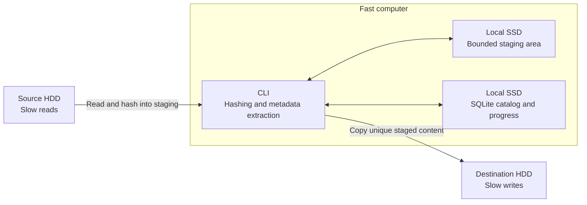
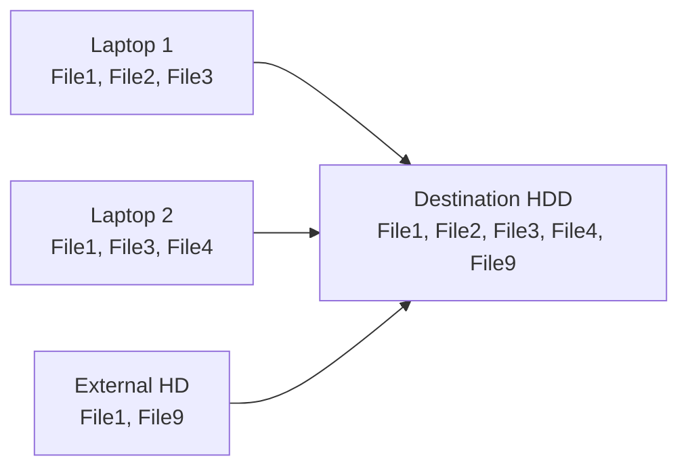
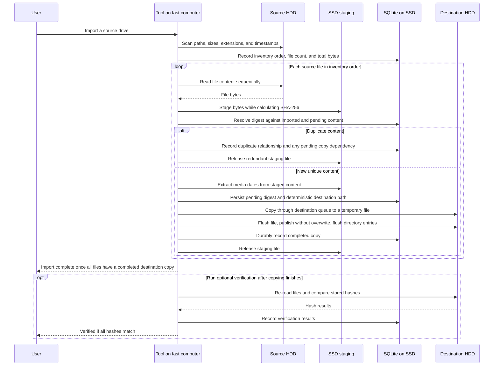

# unduplicator: design and operating notes

For copyable commands and a quick interpretation of the new PASS / REVIEW / FAIL
verdict, start with the [README](../README.md).

A resumable, copy-only CLI that imports files from removable drives into one destination. It keeps one SHA-256-identified copy of each unique file and tracks progress in SQLite.

## Setup

Build with Rust 1.85 or newer, Cargo, and a C compiler (bundled SQLite is built
from source). Keep Cargo.lock to use the resolved dependency versions.
ExifTool is required on PATH before a new import.

On Omarchy:

```sh
omarchy pkg add base-devel rust perl-image-exiftool
```

```sh
cargo build --locked
cargo run --locked -- --help
cargo run --locked -- import --help
```

Import, resume and verification workflow:

```sh
./target/debug/unduplicator import --source /mnt/source \
  --destination /mnt/destination --catalog /ssd/catalog.sqlite \
  --staging /ssd/staging --staging-budget 1073741824 --verify
./target/debug/unduplicator resume --catalog /ssd/catalog.sqlite --run 1 --verify
./target/debug/unduplicator verify --catalog /ssd/catalog.sqlite --run 1
./target/debug/unduplicator runs --catalog /ssd/catalog.sqlite
./target/debug/unduplicator report --catalog /ssd/catalog.sqlite --run 1
```

The source must exist. Destination, staging, and the catalog must have disjoint
paths, and none may overlap the source. Existing symlink ancestors are resolved
before checking; source symlinks will not be followed during inventory.
Resume accepts only the catalog, positive run ID, and optional verification;
it will reuse stored roots and budget.

The catalog uses schema version 2, SQLite WAL with FULL synchronization, and an
exclusive import/resume/verify command lock. Concurrent write commands and a different destination are
rejected. Retain the catalog and its lock file. Inventory records native Unix
path bytes, original birth/modification times, extensions and sizes in batches
of 256. Files in each directory are sorted by native name and recorded together
before descending into sorted child directories. Inventory opens no file
content. Symlinks and special files are counted separately and skipped;
inaccessible directories or metadata leave inventory unfinished. A resumed
unfinished inventory is discarded and rescanned; a finalized inventory is reused.
Source completion is derived from committed content dependencies, so duplicates
of a pending copy remain unfinished together.

The tool is designed for a fast computer with two attached slow HDDs:

- **Fast computer:** runs the CLI, hashing, and media metadata extraction.
- **Local SSD:** holds the SQLite catalog, resumable progress, and temporary staging files.
- **Source HDD:** contains the files to import.
- **Destination HDD:** receives the organized, unique files.



The performance goal is to minimize repeated source reads and HDD seeks while allowing the source and destination to work at the same time.

## Import flow



Matching SHA-256 content is stored once, across all imports.

## Import sequence



## Phases

1. **Inventory** — scan source paths, sizes, extensions, and original timestamps into SQLite without reading file content. Record the total file count and byte count for progress reporting. Keep files from the same directory together and retain traversal order as the processing queue. No separate size-grouping or planning pass is needed: every file will be hashed during processing.
2. **Process and import** — read each source file into SSD staging while calculating its full SHA-256 digest. Resolve duplicates against both completed imports and unique content already queued in this run. Extract media dates from staged unique files, determine their destination paths, and copy them from SSD to the destination HDD. Release staging files when they are no longer needed.
3. **Verify (optional)** — after copying finishes, re-read destination files, preferably in recorded write order, and compare their digests. Mark a run `verified` only if every required digest matches. Hashing during transfer does not replace this destination reread.

The sequence diagram shows the dependencies for each file. During phase 2, the source can stage the next file while the destination copies a previously staged file. SSD staging normally allows one full source read per file and one destination write per unique file. Duplicate detection still requires the full source digest; duplicate content is discarded from staging without being written to the destination.

## Progress

Output includes durable `done/total` source-file counts, source bytes read,
destination bytes transferred against currently known unique content, recovery
validation bytes, and approximate ETA. Source bytes include oversized unique
copy rereads and representative-source validation during recovery. Destination
bytes are session transfers, including retries; known unique bytes describe run
dependencies and may include copies completed in earlier sessions/imports.
Verification bytes are a separate counter and estimate. Staging peak includes
recovered occupancy. Totals appear only after inventory is finalized; symlink
and special-file skip counts are printed separately.

Progress refreshes on terminals and prints periodic lines when redirected.
Throughput is smoothed from byte samples; unseen unique demand is refined using
the observed unique-byte fraction. ETA uses the larger remaining source/copy
demand for independent disks and sums demands when serialized, including queued
destination work and oversized rereads. Startup and zero-byte-only work show
Estimating. Estimates are approximate, especially while the unique fraction is
unknown or filesystem flushes dominate transfer time.

`--verify` waits for the copy workers to drain, then rereads distinct required
destination files in durable write order. Every requested pass starts fresh,
even after an interrupted verification, and persists each digest result. A run
is marked verified only after all required sizes and hashes match. Missing,
unreadable or mismatched files produce verification-failed and an error exit.
Successful import without verification is explicitly reported as unverified.

Exit statuses: 0 for successful requested work; 1 for dependency, copy, catalog
or verification failures; 2 for invalid invocation/root configuration; 130 for
interruption. Failed/interrupted created runs print their run ID and resume
command. Resume with `--verify` retries unfinished copies before a fresh pass.

Show completed source files against the inventory total, such as `4 of 100000 done`, along with bytes read, destination copy progress, and an approximate time remaining. Count a source file as done only when its destination copy is durably complete; duplicates of pending content wait for that shared copy to complete.

Estimate time from observed byte throughput and remaining source reads and destination writes, accounting for overlap between the disks and extra reads in the oversized-file fallback. File counts alone give poor estimates when file sizes vary. The amount of unique content is initially unknown, so refine the estimate as processing discovers duplicates and show `Estimating…` until enough work has completed. Include the remaining destination queue after source reading finishes. Optional verification has its own progress and estimate.

## HDD scheduling and staging

The implementation uses one source worker, one destination worker and a SQLite
coordinator. Each job channel holds at most 2 jobs and the event channel holds
4 events. Byte reservations are also limited to 4 files, including empty files
and oversized jobs. Normal files reserve their recorded size and are hashed
while written to an exclusive stage using a 1 MiB buffer. Duplicate stages are
removed immediately; unique stages and reservations remain until filesystem
finalization and catalog commitment. Staging is tool-owned; do not put unrelated
files in it or share it with another catalog.

Linux topology discovery resolves block devices and partition parents through
sysfs. Known separate source/destination devices permit overlap. Unknown,
virtual or ambiguous topology is conservatively serialized. If staging shares
a source/destination device, its access takes that device gate too. Oversized
files reserve no staged bytes, hash once, and reread for copying only if unique;
source metadata and fallback copying take the source gate. Failed work cancels
reservations and disconnects bounded queues so workers can stop without deadlock.

- Use one active content reader per physical source HDD and one active writer per physical destination HDD. Overlap work across the two disks, with hashing and metadata work on the fast computer.
- Use large buffered transfers and bounded queues. Avoid interleaving several file streams on the same HDD or mixing destination verification with copying.
- Preserve directory locality when reading. Traversal order is a practical heuristic, not a guarantee of physical disk order.
- Give SSD staging a configurable space budget; it does not need to hold the entire import. Pause source reads when the budget is full and resume as completed files release space.
- For a file larger than the staging budget, fall back to hashing it on the source, then rereading it for copying only if it is unique. Extract any required metadata from the source in this fallback. This costs extra source I/O but keeps staging bounded.
- Keep destination naming and duplicate representative selection deterministic, independent of worker completion order.
- Index SQLite digest lookups and batch progress updates into short transactions. Track staged, pending, and completed content so interrupted work can resume. Use the finalization order below when committing completed copies, including batched commits.

## Copy finalization and crash recovery

The current publication adapter supports Linux. It publishes through an atomic
same-filesystem hard link from the exclusive destination temporary file, then
unlinks the temporary name. Existing final names are never replaced. Finished
content is synced before publication; new directories and their parents are
synced on creation, and final ancestors through the destination's parent are
synced before catalog completion. Unsupported hard links or directory fsync,
and failed file/directory/catalog operations, report errors and preserve pending
work. Validated on this Linux host with real temporary-directory files; other
platforms are explicitly rejected. Successful flush calls still depend on the
filesystem/device honoring them. Operation-order and process-crash tests do not
prove survival of actual power loss.

1. Persist the pending digest, source reference, and intended destination path in SQLite before starting the destination copy.
2. Write to a temporary file on the destination filesystem. Flush the completed file to durable storage, then atomically publish it at the final path without replacing an existing file. Flush the affected directory entries, including newly created parent directories, before proceeding.
3. Durably commit the completed state in SQLite, then release the staging file. Duplicates linked to this content become complete only after this commit.

On restart, reconcile pending records with destination files and staging files. If the final destination file already exists, check its digest before adopting it as complete; this handles a crash after publication but before the SQLite commit. Validate recovered staging or temporary content before reuse, and retry incomplete copies from valid staging or the unchanged source. Never overwrite a conflicting final file. Failed copies and their dependent duplicates remain unfinished and must be reported; the run is complete only when every inventoried file has a completed destination copy.

Recovery drains existing pending work before allowing new staging reservations,
including when recovered stages fill the budget. Matching finals are flushed and
adopted without another copy. Complete temporaries are reused; partial temporaries
are removed and retried from validated staging or a fully validated representative
source. Leftover stages for committed rows are cleaned without recopying. Orphan
cleanup removes only catalog-owned staging names or recorded redundant temporary
paths; unknown/unrelated names and destination final paths are preserved.

A small recovery trial:

```sh
mkdir -p /tmp/unduplicator-trial/source
printf 'example\n' > /tmp/unduplicator-trial/source/example.txt
./target/debug/unduplicator import --source /tmp/unduplicator-trial/source \
  --destination /tmp/unduplicator-trial/destination \
  --catalog /tmp/unduplicator-trial/catalog.sqlite \
  --staging /tmp/unduplicator-trial/staging --staging-budget 1048576
# After Ctrl-C or a failed copy, use the printed Run ID (for example 1):
./target/debug/unduplicator resume --catalog /tmp/unduplicator-trial/catalog.sqlite --run 1
```

Automated child-process tests execute deterministic interruptions at seven
publication windows and then run the same resume command shape. They validate
process-crash recovery; they do not simulate physical power loss.

## Source safety

The tool never modifies, moves, or deletes source files.

## Destination

- Media: `/Media/YYYY/YYYY-MM/YYYY-MM-DD/`
- Media with unknown dates: `/Media/Unknown/`
- Other files: `/Other/`
- Different content with the same destination name: add a deterministic SHA-256 suffix; never overwrite.

Date priority: image/video metadata, filename, original source filesystem timestamps, then `Unknown`. Staging timestamps do not replace source timestamps. Filesystem timestamps may not be capture dates.

ExifTool is invoked read-only on unique staged media; oversized media uses the
original source. Valid EXIF DateTimeOriginal wins, then XMP DateCreated,
QuickTime CreationDate, then embedded CreateDate. Filesystem tags returned by
ExifTool are excluded. Missing, malformed or invalid metadata produces a
diagnostic and permits fallback. Calendar dates retain their literal date even
with offsets; no host timezone conversion occurs. Filename matching chooses
the leftmost valid YYYY-MM-DD, YYYY_MM_DD or YYYYMMDD with numeric boundaries.
Invalid dates and zero placeholders are rejected. Original birth time wins over
modification time, both interpreted in UTC; neither usable means Unknown.

The first inventory-ordered claimant represents each new digest; existing
digests keep their representative, path, date and provenance. A reserved or
existing basename receives `stem-FULL_LOWERCASE_SHA256.extension`. If that name
also conflicts, the tool reports an error. Native Unix basenames are retained.
Catalog reservations include temporary names. Temporary names receive a
deterministic numeric suffix when needed so they never alias a reserved final
name, including a source basename resembling the tool's temporary namespace.
Real metadata fixtures currently cover JPEG and MP4; all listed extensions have
classification tests, which do not establish metadata coverage for every format.

## Supported media

- Images: `.jpg` `.jpeg` `.png` `.heic` `.heif` `.gif` `.bmp` `.tiff` `.tif` `.webp`
- Videos: `.mp4` `.mov` `.avi` `.mkv` `.wmv` `.m4v` `.3gp` `.flv`
- Everything else goes to `/Other/`.

## Operating assumptions

- Source contents, paths, and metadata remain unchanged throughout an import and any resumed work. The tool relies on this stability, including when oversized files are read twice; detecting external source changes is out of scope.
- The destination is changed only by this tool, and the same destination is used across imports and resumes. Completed catalog entries are trusted. Detecting external edits, deletions, or replacement drives is out of scope.
- The local SQLite catalog is retained. If it is lost, the import will be redone from the sources. Catalog backup and automatic reconstruction after catalog loss are out of scope.

## Saved run reviews

Import, resume, and verification print a concise summary and save the complete
review text in `run_reports(run, generated_at, report)`. `report` renders the
same summary from the saved text, while `report --full` shows that text. There is one
latest report per run; another resume or verification replaces it. Handled
failures and interruptions also save and print a review, retaining exit 1 or
130. Failures before a run can be opened/created and abrupt process termination
cannot save a report.

```sh
# List runs, their phases, inventory totals, source paths and saved-report times.
./target/debug/unduplicator runs --catalog /ssd/catalog.sqlite
# Read the saved review, without rerunning the import or verification.
./target/debug/unduplicator report --catalog /ssd/catalog.sqlite --run 1
```

Summaries show a PASS / REVIEW / FAIL verdict with reasons, elapsed time, files
found, destination content ready, files copied in the last invocation, duplicate
source copies, and current errors. Older saved reviews lack a copied-file count;
their summary shows written bytes and identifies the missing count. PASS requires a
complete, reconciled inventory, completed content, a complete passing destination
verification, and no skipped entries. REVIEW covers unverified or unfinished
work and skipped symlinks or special files. FAIL covers reported errors, failed
verification, and count inconsistencies. Reviews contain roots and budget, inventoried/skipped files, source bytes,
oversized-file counts, distinct content, within-source duplicate counts and
redundant bytes, content referenced by earlier runs, completion and pending
counts, extension and date-provenance breakdowns, current errors, and the latest
verification pass/results. The ten largest within-source duplicate groups show
up to ten source paths each and their destination mappings; omitted groups and
paths are counted explicitly. All current stored file and latest verification
errors are included. Paths and messages escape control characters for terminal
review. Native non-UTF-8 paths are displayed lossily, as elsewhere in the CLI.

The saved review also records elapsed seconds, files copied, source/destination/recovery/
verification byte counters, and staging peak **for the last invocation**. These
are not cumulative across resumes. Cross-run matches are references in this
catalog, not a scan of arbitrary destination files or a historical count of
files already present when the run began. Duplicate statistics for unfinished
runs cover only hashed files; unfinished inventory counts are explicitly partial.

`runs` and `report` open the database read-only and can run during an import.
They do not require ExifTool, access to the original source, or the import lock.
A saved review is a snapshot at its displayed timestamp, not a fresh filesystem
check. If an old run or crashed run has no saved report, `report` renders the
current catalog snapshot without persisting it. Version-1 catalogs migrate
without losing existing records the next time import/resume/verify opens them;
viewing alone does not migrate the database. Older version-1 binaries cannot
open a migrated version-2 catalog.
